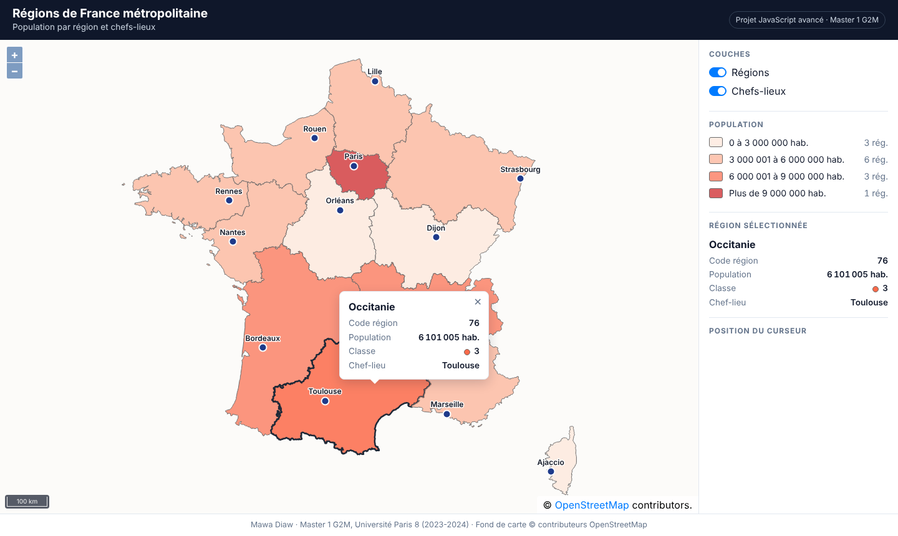
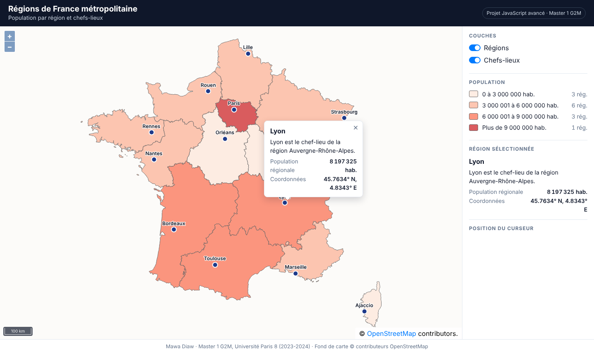
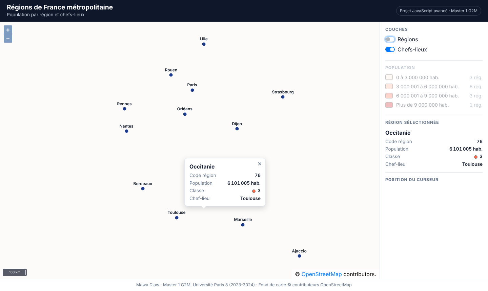

# Carte des régions de France métropolitaine — OpenLayers

Carte interactive des 13 régions de France métropolitaine : population en quatre classes et chefs-lieux de
région. Réalisée en **JavaScript** avec **OpenLayers 6.5** et **Bootstrap 4.6**.

Projet final du module *Langages Web 3 (JavaScript avancé)*, Master 1 G2M (Géomatique), Université Paris 8 — 2023-2024.

**▶ Démo en ligne : [mawa399.github.io/carte-regions-france-openlayers](https://mawa399.github.io/carte-regions-france-openlayers/)**



## Fonctionnalités

- **Fond OpenStreetMap**, vue cadrée sur la France métropolitaine, **échelle linéaire**.
- **Régions** colorées selon la population (bordure #6b6b6b de 1 px, remplissage à 70 % d'opacité) :

  | Classe | Population | Régions |
  |---|---|---|
  | 1 | 0 à 3 000 000 | Bourgogne-Franche-Comté, Centre-Val de Loire, Corse |
  | 2 | 3 000 001 à 6 000 000 | Bretagne, Grand Est, Hauts-de-France, Normandie, Pays de la Loire, Provence-Alpes-Côte d'Azur |
  | 3 | 6 000 001 à 9 000 000 | Auvergne-Rhône-Alpes, Nouvelle-Aquitaine, Occitanie |
  | 4 | plus de 9 000 000 | Île-de-France |

- **Chefs-lieux** créés à partir d'une classe `ChefLieu` (`nom`, `region`, `lon`, `lat`, `getDescription()`),
  affichés en points avec leur nom.
- **Cases à cocher** liées à la visibilité de chaque couche.
- **Popup et fiche** au clic : nom, code, population, classe et chef-lieu d'une région, ou description d'un chef-lieu.
- Survol des régions, **légende** avec le nombre de régions par classe, **position du curseur** en degrés.
- Mise en page adaptée au mobile.

| Chef-lieu | Chefs-lieux seuls |
|---|---|
|  |  |

## Points techniques

- **Opacité du remplissage** : `ol.style.Fill` n'a pas d'option `opacity`. Les 70 % sont donc placés dans la
  couleur elle-même (`rgba(r, g, b, 0.7)`).
- **Métropole uniquement** : le fichier `data/regions.js` (à ne pas modifier) contient aussi les 5 régions
  d'outre-mer. Elles sont écartées au chargement (codes inférieurs à 10), sans toucher au fichier.
- **Projection** : les données sont en WGS 84 (EPSG:4326) et la carte en Web Mercator (EPSG:3857) ;
  la conversion se fait à la lecture du GeoJSON et dans `ChefLieu.toFeature()` avec `ol.proj.fromLonLat`.
- **Étiquettes** : le nom des chefs-lieux n'apparaît qu'à partir d'un certain zoom (style dépendant de la résolution).
- OpenLayers 6.5.0 est inclus dans `lib/` (build officiel), le site ne dépend donc d'aucun CDN pour la carte.

## Lancer le projet

Aucun serveur n'est nécessaire : ouvrir `index.html` dans un navigateur.
Ou, pour un serveur local : `python -m http.server` puis http://localhost:8000.

## Structure

```
├── index.html            page unique
├── css/style.css         mise en forme
├── js/ChefLieu.js        classe ChefLieu et liste des 13 chefs-lieux
├── js/app.js             carte, couches, styles, légende, popup
├── data/regions.js       GeoJSON des régions (fourni, non modifié)
├── lib/openlayers-6.5.0  OpenLayers 6.5.0
├── sujet/ENONCE.md       énoncé du projet
└── captures/             captures d'écran
```

## Auteur

**Mawa Diaw** — [GitHub](https://github.com/mawa399) · [LinkedIn](https://www.linkedin.com/in/mawa-diaw)
